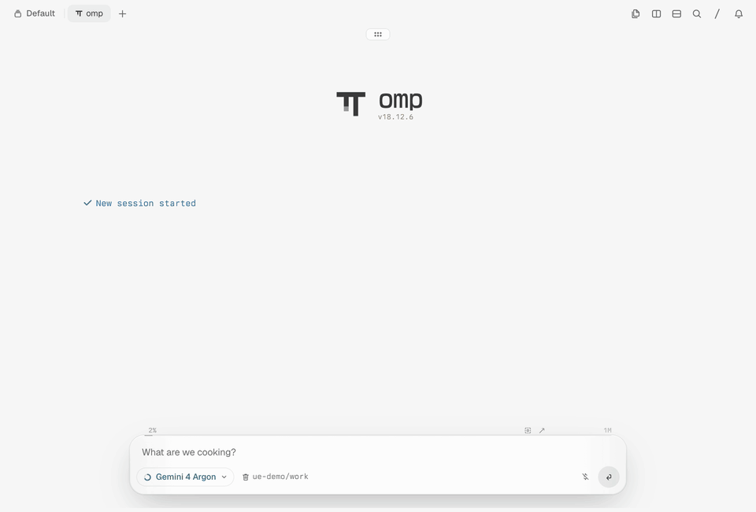
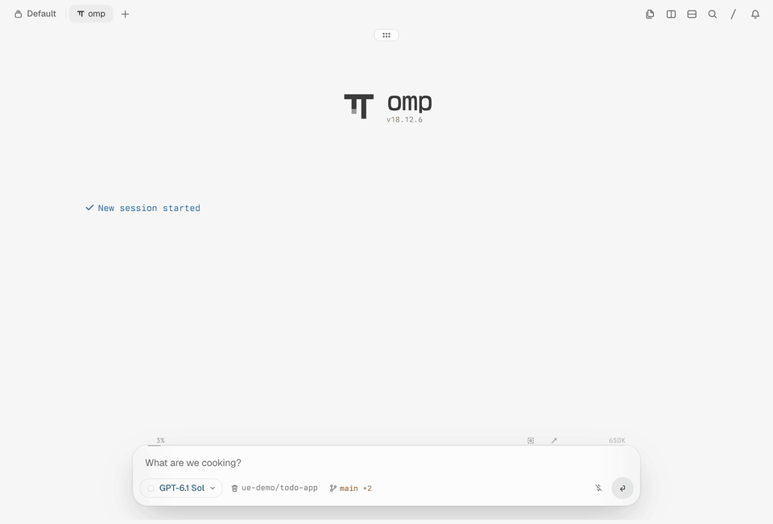

# omp-unified-exec

[English](README.md) | 简体中文

为 [oh-my-pi](https://github.com/can1357/oh-my-pi)（omp）提供长时间运行的终端
会话，并在 Tern 里带一个终端 HUD。宿主的 `bash` 负责短的一次性命令；长命令、交互程序（REPL、TUI、`ssh`、`sudo`）、并发计算和开发期 daemon 交给 `exec_command`，它把每条命令放进一个 PTY 会话，由模型通过写入、读取和 monitor 来驱动，而不是一次阻塞到底的调用。会话在多轮对话之间持续运行，没有命令截止时间，人也可以在 Tern 里查看它们、向它们输入。

[](docs/assets/demo.mp4)

agent 用 `exec_command` 启动 `python3 -q`，再通过 `write_stdin` 执行 `x = 21`。人点击 omp 运行中计数药丸的终端分段打开这个会话，在终端页里输入 `y = x * 2`；随后 agent 在同一会话里打印 `y`，得到 42。最后在 Terminals 视图里用 Kill 结束会话。录制环境为 Tern、omp 18.12.6 与 Gemini 4 Argon，模型轮次以 3 倍速播放。原分辨率视频：[docs/assets/demo.mp4](docs/assets/demo.mp4)。

[](docs/assets/demo-lazygit.mp4)

全屏 TUI 也一样。使用 GPT-6.1 Sol 时，agent 用 `exec_command` 打开 lazygit，只靠 `write_stdin` 操作它：只暂存 `src/todos.ts`，以 `feat: toggle todos` 提交，`README.md` 保持未暂存。人在终端页里打开同一个 lazygit（带颜色），按 `4` 切到提交面板查看新提交的补丁，再按 `q` 退出；随后 Terminals 视图显示该会话 `Exit 0`。模型轮次以 3 倍速播放。原分辨率视频：[docs/assets/demo-lazygit.mp4](docs/assets/demo-lazygit.mp4)。

本仓库 fork 自 [iamwrm/pi-unified-exec](https://github.com/iamwrm/pi-unified-exec)，后者是 codex `unified_exec` 的 Pi 移植。原有工具（`exec_command`、`write_stdin`、`set_on_exit`、`kill_session`、`list_sessions`）保留其会话模型；fork 让每个会话都按宿主的 shell 设置在 PTY 中运行，把短命令留给宿主的 `bash`，并为 omp 增加终端读取/截图和 `monitor`。fork 的全部改动、每项改动的原因，以及 omp/Tern 升级后如何重新验证，见 [fork-features/README.zh-CN.md](fork-features/README.zh-CN.md)。

## 安装

```bash
omp install https://github.com/oh-my-omp/omp-unified-exec
```

请先卸载已有的 `pi-unified-exec`（`omp plugin uninstall pi-unified-exec`）：两者注册的是同一组工具。本 fork 不向 npm 发布任何内容。

更新时执行同一安装命令并加上 `--force`：

```bash
omp plugin install https://github.com/oh-my-omp/omp-unified-exec --force
```

本扩展不需要 Tern 插件。0.14.7 及以前的版本会安装一个 Tern 插件（`omp-unified-exec`）；PATH 中存在 `tern` 时，加载本扩展（包括安装校验）会通过 Tern 自己的 CLI 移除那份副本或链接。

本插件只支持运行于 Bun 1.4+ 的 omp（omp 是编译后的 Bun 可执行文件）。Pi 等非 omp 宿主会在扩展 factory 阶段立即收到明确的“only supports omp”错误。每个会话都使用 Bun 原生的 `Bun.Terminal`；宿主缺少 `Bun.spawn` 或 `Bun.Terminal` 时，也在同一 factory 阶段被拒绝，早于 omp 模块加载和任何工具注册。

## 功能

- **会话，而不是调用。** `exec_command` 在 PTY 中启动进程，在等待窗口内返回已有输出和一个 `session_id`；之后的轮次里，`write_stdin` 把字节原样写给它（文本、`\x03` Ctrl-C、方向键）。状态与内容用 `read terminal_url` 读取，事件与完成用 `monitor` 等待。取消调用永远不会杀掉进程。没有命令截止时间，退出的进程也不会被重启。
- **宿主的 shell。** 调用没有指定 `shell` 时，命令使用 omp 的 `shellPath` 设置，未设置时用环境变量 `SHELL`，再没有则用平台默认值。每个结果都写明启动所用的 shell，模型据此按该 shell 的语法写命令。
- **输出就是终端上看到的内容。** 每个会话都经过无头终端模拟器。运行中的结果返回当前屏幕、自上次调用以来滚出的未见历史与光标位置，而不是叠加每次重绘；退出结果只返回最终活动屏，其余保留行通过 `terminal_url` 读取。模拟器会像真实终端一样回应光标位置、设备属性与默认颜色查询，因此等待回应或选择配色的程序表现与真实终端一致。
- **输出有上限，完整内容可找回。** 模型看到的每个结果都从尾部截取，最多 50 KiB / 2000 行，并去掉终端控制序列；每个会话的完整原始输出都写入 `log_path`。
- **终端生命周期。** 后台终端的命令返回后，终端仍保留在列表里，直到被回收。异常返回立即提醒；返回或最近一次读取 30 分钟后，从未读过的终端收到一条读取提醒，读过的终端收到一条即将回收提醒，并有 5 分钟反悔期，期满仍未再读就结束其剩余进程并回收。见[终端生命周期](#terminal-lifecycle)。
- **统一的通知通道。** 完成唤醒、monitor 的返回与提醒、等待输入提醒和生命周期通知都是终端通知：每条用 `session_id` 和传给 `exec_command` 的标题指明终端，并附一句简短原因；同时待发的多条通知合并成一条唤醒 agent 的后续消息。
- **可选的完成唤醒。** `on_exit: "wake"` 让后台进程在无人观察时退出后唤醒一次 agent；`set_on_exit` 可以取消。
- **等待匹配输出。** `monitor` 不消费输出地观察已有会话，在匹配批次或结束时唤醒模型；默认最多成功返回十次匹配消息。monitor 20 分钟没有返回时，会提醒 agent 一次去检查会话。
- **等待输入提醒。** 无论有没有 monitor，会话屏幕停在 agent 还没看过的提示上（`apt upgrade` 询问 sshd_config 这类 debconf/whiptail 对话框、`[Y/n]`、密码、分页器）时，都会唤醒 agent。
- **omp 原生呈现。** `exec_command`、`write_stdin` 和 `kill_session` 用 omp 自己的 bash 卡片渲染（命令行、输出、退出码标签、错误配色），在 ANSI TUI 和 Tern 里都是如此。
- **Tern 里的终端 HUD。** 不用调用工具，就能查看、回滚、输入并结束模型的会话。

<a id="tern-hud"></a>

## Tern 终端 HUD

当 omp 在 Tern 里原生渲染、并且存在会话时：

- **终端分段。** 一个终端图标加存储中的会话数，作为 omp 自己运行中计数药丸的分段，排在 agents 和 jobs 分段之后，同在一个胶囊里；悬停标签还给出仍在运行的数量。药丸、分隔线以及各 chat style 和配色主题都由 Tern 绘制。最后一个会话被移除后分段消失；若 agents 和 jobs 也都没有，药丸整个消失。
- **Terminals 视图。** 点击终端分段打开一个仿照 omp Background jobs 视图的视图，在每个主题和 chat style 下都由 Tern 为该视图准备的自带样式绘制：居中卡片，左侧列出会话（终端图标、标题、已运行时间，按状态着色），右侧是选中会话的详情：状态行（Running / Exit N、已运行时间、`exec · #id`、运行中才有的 Kill、Open）、完整命令、目录、PID、尺寸、启动时间、可点击的日志路径，以及跟随最新行的彩色输出。页脚显示运行中和存储中的数量以及 Close。↑/↓ 或点击选择会话，`x` / Kill 按 `kill_session` 的方式结束它，Esc / Close 关闭视图。卡片标题的图标是 Tern 为 jobs 视图绘制的图标。
- **终端页。** Enter / Open（或双击）把会话打开成一个按 omp Console 框架显示、以其标题为题头的全屏页：显示保留的历史和当前屏幕，带颜色、按会话自身宽度显示，跟随新输出，并可向上回滚。键入的按键会发给会话（与 `write_stdin` 的写法相同，模型能看到效果）；Esc / Back 返回视图；Kill 结束会话。

HUD 直接读取会话，不保存任何副本。它只在 omp 原生渲染时存在，因此 omp 的 ANSI TUI 不会多出一行。工具结果仍是纯文本；显式 `read term://…/screen.png` 请求返回图像。

**分段如何并入 omp 的药丸。** omp 没有给扩展加药丸分段的 API，所以 HUD 在每个进程里包装一次 omp 的 `InteractiveMode.prototype.describeHudPills`，把自己的分段组件追加为药丸的最后一个子节点；omp 没有药丸时由包装创建。omp 自己的行对象从不被修改。扩展重新加载时只替换装饰函数，不再包装第二次。如果 omp 不再有这个方法，或返回其他形状的行，加载或描述时报 "requalify" 错误，而不是静默不显示分段。

**不需要 Tern 插件。** 视图和终端页使用 omp 自己的 overlay role（`omp.overlay.jobs`、`omp.overlay.console`），所以视图、终端页和终端分段都由 Tern 的自带样式绘制。这些 role 是 omp 与 Tern 的展示层契约，升级时需重新验证。本扩展会移除早期版本安装的 `omp-unified-exec` Tern 插件，因为它的样式表仍会移动 omp 共享的 widget 容器：在 omp 等待的扩展 factory 中，先执行 Tern 的 `plugin list`，再执行 `plugin remove`（Tern 回答它是链接时改用 `plugin unlink`），然后确认 Tern 不再列出它。没有 `tern` 时什么也不做；Tern 可用但失败时，加载失败并给出它的诊断信息。

## 工具

### `exec_command`

在一个持久的 PTY 会话里运行命令。用于长命令、交互程序（REPL、TUI、`ssh`、`sudo`）、并发计算和开发期 daemon；短的一次性命令用宿主的 `bash`。没有命令截止时间，退出的进程也不会被重启。用 `monitor` 和 `read term://…` 观察会话，用 `write_stdin` 发送输入；输出是渲染后的终端屏幕（见[终端输出](#terminal-output)）。

| 参数 | 类型 | 默认值 | 说明 |
|---|---|---|---|
| `cmd` | string | — | Shell 命令。必填。 |
| `title` | string | — | 必填的启动标题，在 `list_sessions`、Terminals 视图和每条有关通知里指明这个终端。折成一行，最多保留 80 个字符。缺失或全空白时调用在启动任何进程之前失败。 |
| `workdir` | string | 宿主会话的 cwd | 工作目录。默认值在每次调用时从宿主读取；会话里的 `cd` 不会改变它。相对路径按该会话 cwd 解析。路径不存在或不是目录时，以 `Working directory does not exist: <路径>` / `Working directory is not a directory: <路径>`（与宿主 bash 相同的文案）失败，不启动任何进程。 |
| `shell` | string | omp `shellPath`，否则 `SHELL`，否则 `bash` | Shell 可执行文件，见 [Shell 选择](#shell-selection)。`cmd` / `powershell` / `pwsh` 会带上各自对应的参数；其他 shell 一律使用 `-c`。 |
| `cols` | number | `120` | PTY 宽度。限制在 [20, 500]。 |
| `rows` | number | `80` | PTY 高度。限制在 [5, 300]。 |
| `yield_time_ms` | number | `10_000` | 本次调用保持连接、等待输出的时长（不是命令的生命期），限制在 [250, 30_000]。 |
| `on_exit` | `"none"` \| `"wake"` | `"none"` | 无人观察时进程退出的处理策略。`"wake"`：发一条后续提示唤醒 agent——仅在人明确希望自动恢复时使用。之后可用 `set_on_exit` 修改。 |

响应体（运行中、输出较短、未截断时）：

```
[still running]                     (or [exited])
session_id: 1                       (mutually exclusive with exit_code)
exit_code: 0                        (mutually exclusive with session_id)
signal: SIGTERM                     (optional, if killed)
log_path: /tmp/pi-unified-exec-41237-1-5cc5e104.log  (omp pid, session id, random)
terminal_url: term://1-9f2c1a7e-…
cwd: /home/you/project
shell: /bin/zsh                     (absolute path of the shell the session started with)
wall_time_seconds: 0.502
chunk_id: a4f2c1
original_token_count: 37
output_bytes_total: 148            (cumulative bytes since spawn)
terminal: normal screen 120x80, cursor row 4 col 5
history_lines: 2                   (running, optional: lines scrolled off above the screen since the last call)
---
<history lines not yet reported>
<the full current screen, trailing blank rows removed>
```

输出超过上限（50 KiB / 2000 行）时，末尾会附上一行说明：

```
...tail of output...

[Showing lines 3900-4120 of 4500 (50.0KB limit). Full output: /tmp/pi-unified-exec-41237-1-5cc5e104.log]
```

#### 命令审批

启动进程之前，omp 用与内置 `bash` 相同的审批逻辑检查原始 `cmd`：
有序的 `bash.patterns`（`allow`、`deny`、`prompt`）、`bash.allowCompoundCommands`
与危险命令模式。deny 阻止执行；确认详情显示 `Command: <命令>`（只为显示而截断）。
允许 `true` 不会顺带允许 `true && echo x`，除非启用复合命令审批且每一段都被允许。
omp 的审批模式仍然生效：在 `yolo` 下，显式 deny/prompt 策略生效，
但仅有危险模式 override 不会要求确认。

每次审批实时读取调用方会话的规则，包括子 agent 自己的 settings overlay。
第一次 `session_start` 按 agent id 和 session-manager 身份绑定会话；
switch 与 branch 只复核身份。绑定不可用或失败时，审批返回宿主默认的 `exec`
级别，不读取其他会话的 settings，也不因此禁用执行。只有 `exec_command`
增加这套逻辑；之后经 `write_stdin` 写入的输入不会被重新解释为待审批的新命令。

<a id="shell-selection"></a>

#### Shell 选择

每个新进程使用下列第一个已设置的值；空白的 `shellPath` 或 `SHELL` 视为未设置：

1. 调用的 `shell` 参数；
2. omp 的 `shellPath` 设置：每次启动进程时从 omp 的设置注册表读取，而不是在加载时复制一份；
3. 环境变量 `SHELL`；
4. 平台默认值：`bash`；Windows 上依次探测 Git Bash，最后是 PowerShell（见 [Windows](#windows)）。

进程启动前，选中的 shell 会被解析成绝对可执行路径：裸名称经 `PATH` 查找，包含 `/` 或 `\` 的相对路径相对于实际生效的 `workdir` 解析。选中的 shell 找不到或无法启动时，调用失败（`failure_message: spawn <file> ENOENT: …`；Windows 上若 `PATH` 中找不到该 shell，则报错并给出其名称）；命令绝不会改用优先级更低的 shell 执行。

`cmd`（Windows）使用 `/d /s /c` 及其自身的引号规则，`powershell` / `pwsh` 使用 `-NoProfile -NoLogo -Command`；其他 shell 都以 `<shell> -c <cmd>` 运行。命令文本原样传入，所以要按结果中写明的 shell 的语法来写。

结果头、`details` 和 `structuredContent` 都以 `shell` 字段给出解析后的可执行文件：短命令、已启动的会话和启动失败都一样。`write_stdin` 结果、流式更新、`kill_session` 结果和 `list_sessions` 条目沿用会话启动时的 shell，不会重新选择。shell 只是元数据，从不加入 `output`。

<a id="terminal-output"></a>

#### 终端输出

每个会话把子进程写出的每个字节按顺序送进一个尺寸为会话 `cols`×`rows` 的无头终端模拟器（[`@xterm/headless`](https://www.npmjs.com/package/@xterm/headless)），每次结果报告的是这个终端显示的内容，而不是原始输出流。因此每次读取都受屏幕尺寸约束；原始输出流只写入 `log_path`。

- **运行中历史加屏幕。** 先给出自上次调用以来从顶部滚出、且尚未报告过的行，再给出完整的当前屏幕。回车刷新的进度条和重绘只显示最终状态。
- **运行中屏幕未变。** 屏幕、光标和历史都没变化时，结果带 `screen_changed: false` 和 `(no output)`。
- **退出只返回一屏。** 每一种退出结果（包括短命令和确认终止）都返回冻结的最终活动屏，即使屏幕没有变化。`terminal_url` 保留在结果根层；`terminal.retained_rows`、`terminal.rows` 与 `terminal.history_may_be_truncated` 描述正常屏的保留投影，最终元数据不含 `screen_changed` 或 `history_lines`。结果仍受 50 KiB / 2000 行上限约束；通过 URL 的 `/screen` 读取完整屏幕，通过 `/page/N` 读取更早的保留行。
- **全屏程序**（备用屏幕，比如 `top`、编辑器、`tmux`）报告为 `terminal: alternate screen …`；退出后恢复普通屏幕。
- **子进程看到的是 `TERM=xterm-256color`**，即它实际绘制所在的终端，与 omp 自身运行在哪个终端里无关；命令仍可自行设置 `TERM`。
- **工具结果只有纯文本和光标。** exec/write/kill 文本里没有颜色；Tern 的终端页和显式 `read term://…/screen.png` 会显示颜色。
- **终端查询会被回应**，回应写到子进程的输入上：光标位置、设备属性，以及默认前景色/背景色（OSC 10/11）。颜色跟随 omp 的主题（浅色或深色，在 Tern 里跟随 Tern 的外观）。
- 两次调用之间的历史受单元格预算限制（`TERMINAL_HISTORY_CELLS` 除以 `cols` 得到行数）。在被报告之前就超出预算的行会使结果带上 `history_may_be_truncated: true`；这些行只存在于日志中。

#### 在 omp 中读取保留终端

结果与 `list_sessions` 带有进程内唯一的 `terminal_url`，例如
`term://3-9f2c1a7e-…`。人在终端里看到的内容可以独立于结果消费来读取：

| 读取路径 | 内容 |
|---|---|
| `term://<key>` | 全部保留的正常屏物理行，去掉行尾空格与末尾空行。全屏程序（比如 `tmux`）占用备用屏期间，改为返回备用屏（备用屏没有历史）；程序离开备用屏后恢复正常屏历史。 |
| `term://<key>/screen` | 当前活动屏，包括正在使用的备用屏。 |
| `term://<key>/screen.png` | 完整活动网格的图像，带单元格颜色与属性。 |
| `term://<key>/page/2` | `term://<key>` 所读行的第二页，每页是会话的 `rows` 行。 |
| `term://<key>/page/-1` | 最后一页；负页码从末尾计数。 |
| `term://<key>:raw:1-2` / `term://<key>:raw:-3` | 使用 `read` 现有的 head/tail 选择器，raw 模式不附上下文行。 |

读取不会消费输出、推进观察标记或移除会话。对命令已返回的终端的一次完整读取，计入它的[生命周期](#terminal-lifecycle)。
页码越界时报告总页数；未知键返回 `unknown_terminal`。启动失败的会话没有终端资源。

输出关闭且全部已接收字节解析完毕后，会话冻结物理行、活动屏的样式单元格、
尺寸、光标与当时的外观。同一 URL 在短命令结束、自然退出、确认终止、LRU
移除或回收之后仍可读取，直到 omp 进程结束。冻结资源不会删除；插件关闭时不保证
保留尚未冻结的活动投影。子 agent 与扩展重载后的键互不混淆。

`read term://<key>/screen.png` 使用 omp 的图像管线，不要加 `:img`。
网格每格为 8×16 逻辑像素，使用系统等宽字体，宽字符跨两格。
Live 读取使用宿主当前外观并画出描边光标；Frozen 读取保留冻结时的外观，
不画光标。大型网格按同一比例缩小到原生栅格器的像素上限。
每次图像读取都在系统临时目录创建一个私有 PNG；它只是该时刻的副本，
不是缓存，与会话日志一样由系统清理。
从仅支持文本的终端处理器升级时需要重启一次 omp；之后扩展重载会保留
图像处理器与已有 URL。

### `write_stdin`

向已有会话发送解码后非空的输入。省略输入或输入为零字节时，返回类型化错误 `empty_poll_removed`，不消费观察状态，也不影响进程。错误会指向该会话的 `read term://…` 地址与 `monitor`。

| 参数 | 类型 | 默认值 | 说明 |
|---|---|---|---|
| `session_id` | number | — | 必填。 |
| `chars` | string | 不传 | 经 C 风格转义解码后原样写入，不追加任何内容。与 `chars_b64` 互斥；解码后的输入必须非空。 |
| `chars_b64` | string | 不传 | Base64 编码的输入字节，二进制安全；解码后的输入必须非空。与 `chars` 互斥。 |
| `yield_time_ms` | number | `250` | 写入后的连接等待窗口，不是进程超时。限制在 [250, 30_000]；毫秒小数部分向下取整。 |

#### 等待长时间运行的命令

1. 用 `read terminal_url` 或其 `/screen` 读取状态与内容，不消费普通观察。
2. 用带条件的 `monitor` 等待后续输出事件；不带条件则等待输出关闭与进程完成。只有发送输入才用 `write_stdin`。
3. `on_exit` 默认 `"none"`。只有人明确希望自动恢复时才用 `"wake"`；`set_on_exit(session_id, on_exit: "none")` 可在不杀进程的情况下取消。
4. 被带输入工具结果直接观察到的退出会消耗掉唤醒；连接窗口到期或取消则保留唤醒。Monitor End 会把已启用的普通唤醒合并进同一条通知。

连接等待窗口到期永远不会杀掉进程。等待期间的缓存预热由宿主负责，与本包无关。原始日志不设大小上限；七天后的压缩见[语义](#语义)中的**日志**。

#### `chars` 里的控制字节和转义

`chars` 在写入前按 C 风格转义字符串解码。

| 转义 | 结果 |
|---|---|
| `\\n` `\\r` `\\t` `\\b` `\\f` `\\v` | LF CR TAB BS FF VT |
| `\\0` | NUL (0x00) |
| `\\a` | BEL (0x07) |
| `\\e` | ESC (0x1B) |
| `\\xHH`（2 位十六进制） | 单个字节 |
| `\\uHHHH`（4 位十六进制） | Unicode 字符 |
| `\\u{H…H}`（1–6 位十六进制） | Unicode 码点 |
| `\\\\` `\\"` `\\'` | 字面量 `\` `"` `'` |
| 不在上表中的 `\\X` | 原样保留（两个字符） |
| 字符串里的原始字节 | 原样通过 |

```
write_stdin chars="\x03"          → Ctrl-C   (0x03)
write_stdin chars="\x04"          → Ctrl-D   (0x04)
write_stdin chars="\x1b:wq\n"     → ESC + ":wq" + LF     (vim save+quit)
write_stdin chars="\x1b[A"        → ESC + "[A"           (up arrow)
write_stdin chars="C:\\\\temp"    → "C:\\temp"           (must escape \)
write_stdin chars_b64="G3s6wgo="  → exact 5 decoded bytes
```

同时传 `chars` 和 `chars_b64`，或 base64 格式错误，都会拒绝调用。字节原样到达 PTY：不追加任何内容（没有 `\r` 或 `\n`），所以 ESC 和方向键单独发送。终端的行规程把 `\x03`（Ctrl-C）变成发给前台进程组的 SIGINT，把行首的 `\x04`（Ctrl-D）变成规范模式读取程序的文件结束；raw 模式的程序把两者都当作按键读取。提交一行请用 `\r`（回车）：它在所有平台都有效，而 `\n` 在旧版 Windows 控制台里不会执行这一行。

### `set_on_exit`

修改 `on_exit` 策略，**不杀进程**。

| 参数 | 类型 | 默认值 | 说明 |
|---|---|---|---|
| `session_id` | number | — | 必填。 |
| `on_exit` | `"none"` \| `"wake"` | — | `"none"` 取消待发的唤醒（会话被淘汰后留下的协调器墓碑记录同样适用）。`"wake"` 在会话仍在存储中运行时启用唤醒。 |

状态标记：`disarmed`、`already_none`、`armed`、`already_armed`、`too_late`；未知 id 返回 `found: false`。取消无法撤回已经排队交给宿主的后续提示。

### `on_exit: "wake"`——完成通知

> 终端的完成要么通过一个已定稿的工具结果送达，**要么**触发一条合成的模型提示——绝不会两者都有。

- 在 `write_stdin` 观察期间发生的退出由该调用返回，结果定稿时消耗唤醒。结果以错误或取消定稿时，唤醒仍然有效。
- 到期或被取消的调用保留唤醒；进程之后退出时，恰好发送一条后续提示（`deliverAs: "followUp"`，不会打断正在进行的轮次）。同时发生的多个完成会合并成一条提示。
- 唤醒是一条 `exit_wake` [终端通知](#terminal-notices)，只包含有限的元数据（会话 id、标题、退出码/信号、命令、cwd、耗时、终端读取地址、日志路径、失败信息）——绝不包含原始输出。
- `kill_session`、`/unified-exec-sessions` 命令、对存活进程的 LRU 淘汰以及 `session_shutdown` 都会取消唤醒；kill 失败则恢复唤醒。自然退出、尚未通知就被淘汰的唤醒会话会保留一条有上限的墓碑记录，唤醒仍会送达。

### `monitor`

订阅已有运行中会话的后续输出，不停止进程，也不消费普通观察。

| 参数 | 类型 | 默认值 | 说明 |
|---|---|---|---|
| `session_id` | number | — | 已有的运行中会话。 |
| `action` | `"start"` \| `"cancel"` | `"start"` | 建立/替换该会话唯一的订阅，或静默取消。 |
| `condition` | string | 不传 | JavaScript 正则源码（不带 `/` 分隔符）；不传则只在输出关闭时返回。 |
| `max_returns` | number | `10` | 正安全整数，计成功的匹配消息数，不是行数，也不含 End。 |
| `remind_after_ms` | number | `1200000` | 1–2147483647 的整数：monitor 多久没有返回就提醒一次。 |

条件接收新增或改变的渲染逻辑行，包括没有换行的提示符；wrapped 物理行会合并。
在备用屏上，单独的回车（后面不跟换行）或移动光标的 CSI 把光标所在行交给后续输出之前，这一行当时的内容也会参与匹配，
因此 `tmux` 画出又覆盖掉的标记仍能命中。
每行经过清洗，并截取前 1024 个 UTF-16 code unit。纯光标/样式变化不触发，
也不会重放建立前的输出。

约 250 ms 内的匹配合并成一条 `monitor_match` [终端通知](#terminal-notices)并唤醒模型。
每条最多展示 16 行、每行最多 1024 字符，带省略数、成功次数/上限及
会话的 `terminal_url` 与 `log_path`。60 秒内匹配超过 20 个时提示收窄条件，
但继续观察；最后一次允许的匹配注明上限，只结束 monitor，不结束进程。

实际输出关闭时发送 End（一条 `monitor_end` 通知），附尚未返回的匹配和退出码/信号；人工 HUD/slash
与 LRU 终止写明原因。End 合并已启用的普通完成唤醒。模型 `kill_session`、
显式取消、替换、reset 与关闭都静默结束，即使模型 kill 失败也是如此。
已排队交给宿主的后续消息无法撤回。未知/已结束会话、非法正则、非法上限及非法
提醒间隔返回类型化错误。

monitor 建立后或上一次匹配送达后，若 `remind_after_ms`（默认 20 分钟）内没有送达任何匹配或 End，
就发送一条正文带 `silentMs` 的 `monitor_silent` 通知：说明 monitor
没有返回，给出距上次输出的时间、屏幕类型、最后八行非空屏幕内容（标明是命令输出）和终端读取地址，
请 agent 检查会话是在等输入、卡住了还是只是慢。提醒不计入 `max_returns`，也不结束 monitor；
在下一次匹配送达开启新的静默期之前不会重复，所以 agent 要继续等就再调用一次 `monitor` 取得新的期限。
有待发送的匹配时先发匹配，End 会取代尚未送达的提醒。

### 等待输入提醒

没有任何终端协议会告诉宿主“程序正在等输入”。`apt upgrade` 询问本地改过的 `sshd_config` 时走的是
debconf（openssh-server 的维护脚本通过 ucf 调用 debconf）；debconf 经自己的管道与前端通信，
whiptail/dialog 前端到了 PTY 上只是普通的绘制（备用屏、隐藏光标、框线字符）。经过 `ssh` 时，
本机的进程状态也说明不了什么。因此每个运行中的会话在输出安静 5 秒后检查一次渲染后的屏幕，
以下条件全部成立时发送一条唤醒模型的 `input_wait` [终端通知](#terminal-notices)：

- 没有挂着的 `exec_command`/`write_stdin` 调用（它的结果会展示屏幕），也没有工具结果展示过这一屏；
- 屏幕上是一个提示：
  - **dialog**——任意位置出现 `<Ok>`、`<Yes>`、`<No>` 或 `<Cancel>` 按钮（whiptail、dialog、debconf、needrestart）；
  - **inline**——光标停在一行末尾，该行含有 `[Y/n]` 这类选项、`(yes/no)` 或 `(Y/I/N/O/D/Z)`、`[default=…]`，
    或以 `password …:` / `passphrase …:` 结尾，或含 `press Enter/Return/any key`；
  - **pager**——光标在最底行，前面是 `:`、`(END)` 或 `--More--`；
- 这一屏之前没有提醒过。

提醒写明会话、标题和命令，把提示行作为命令输出引用，并给出读取地址。它是启发式的：用 `read term://…`
读过的屏幕不算展示过；shell 提示符、进度行以及不在光标处的提示都会被忽略。同一会话较新的提醒会替换尚未送达的旧提醒；
发送失败时，只要屏幕没变、也没被展示过，就在下一个安全边界重试。

### `kill_session`

| 参数 | 类型 | 默认值 | 说明 |
|---|---|---|---|
| `session_id` | number | — | 必填。 |
| `signal` | string | `"SIGTERM"` | 2 秒后升级为 SIGKILL。`"SIGKILL"` 跳过等待。Windows 上任何信号都会强制结束进程树。 |

信号名会被规范化（`term`、`INT`、`sigkill` 都可以）；未知名称会被拒绝。结果使用与其他工具相同的有上限包装，带 `killed`、`escalated`、请求的/实际的信号和 `running`。kill 失败的会话保留在存储中，并报告 `running: true`。确认的 kill 是正常结束：终端仍留在列表里（`running: false`），由其[生命周期](#terminal-lifecycle)回收；kill 结果展示了最终屏幕，算作读过。Tern HUD 的 Kill 走同一条路径，同样算作读过。

### `list_sessions`

列出存储中的全部终端：运行中的，以及命令已返回、尚未被[生命周期](#terminal-lifecycle)回收的。每条记录带 `title`、启动时的 `shell`、`running`、终端关闭后的 `exit_code`/`signal`、`wake_armed`、活动 monitor 的条件/成功次数/上限/提醒间隔，以及命令返回后的 `lifecycle`：如何返回（`normally` 或 `abnormally (<原因>)`）、是否读过、所处阶段（`ttl`、`unread_reminded`、`grace`、`reclaiming`）。响应带 `running_count`、`returned_count` 和当前宿主时间 `tool_time_utc`。在这里报告退出会取消尚未发出的 `on_exit` 唤醒，但不算读过终端的输出。

<a id="terminal-lifecycle"></a>

### 终端生命周期

从交出 `session_id` 的那次结果起，到回收为止，终端归终端生命周期管理。命令**返回**指 shell 退出（后台进程可能仍持有终端），或终端关闭。

- **异常返回**（非零退出、信号、启动/运行时失败）立即发送一条 `abnormal_return` 通知，读没读过都发。`kill_session`、HUD 或 `/unified-exec-sessions` 的 kill 算正常结束。
- **读取**从返回起计：一次完整的 `read term://…`（文本或 `/screen.png`），或一次已定稿、展示了已返回终端的 `write_stdin`/`kill_session` 结果（shell 已退出时的 `exec_command` 结果也算）。出错或取消的结果不算。`list_sessions`、`monitor` 的 End 和唤醒只报告状态，不算读取。
- 返回或最近一次读取**30 分钟**后：
  - 从未读过：发一条 `unread` 通知；终端一直保留到被读，从不在未读状态下回收；
  - 读过：发一条 `reclaim_due` 通知，进入 **5 分钟反悔期**。反悔期内读取会重新开始 30 分钟；否则回收。
- **回收**结束终端进程组里剩下的一切——Linux 上仍持有终端的后台任务，以及 macOS 上终端关闭后仍在运行的任务（SIGTERM，2 秒后 SIGKILL）——把终端从 `list_sessions` 和 HUD 中移除，并发送一条 `reclaimed` 通知。同一次检查回收的终端共用一条后续消息。`term://` 地址和 `log_path` 仍可读。进程结束不了的终端保留，下次检查再试（Windows 上根进程已退出的进程树无法触及）。
- **检查**每分钟一次，所以每一步最多晚一分钟。
- 达到 64 个会话上限时的 **LRU 淘汰**会发一条注明上限的 `reclaimed` 通知。
- 会话关闭先停止生命周期再结束终端，关闭造成的 kill 不发通知。

<a id="terminal-notices"></a>

### 终端通知

每条有关终端的后续消息都是一条 `unified-exec-notice`，以 `triggerTurn: true`、`deliverAs: "followUp"` 发送：唤醒空闲的 agent，从不打断进行中的轮次。约 250 ms 内待发的通知合并成一条，按终端分组：

```
[unified-exec] 2 terminals: 2 notices. This is execution metadata …
- session_id=3 title="api tests"
  • will be reclaimed in about 5m00s: returned normally, last read 30m00s ago
    No action is needed. …
  read term://3-…
  log_path: /tmp/pi-unified-exec-…
- session_id=4 title="migration"
  • returned abnormally: exit_code=1
    command: npm run migrate
    Read the terminal and decide how to recover.
  read term://4-…
```

`details.notices` 逐条列出 `session_id`、`title`、`kind`、`reason`、`terminal_url`、`log_path` 和带类型的 `body`。种类：`exit_wake`、`abnormal_return`、`monitor_match`、`monitor_end`、`monitor_silent`、`input_wait`、`unread`、`reclaim_due`、`reclaimed`。不再描述其终端的通知（唤醒已被观察或取消、monitor 已取消、屏幕已展示过、一次读取已重启 TTL）不发送直接丢弃。发送失败时在下一次工具结束、agent 空闲或每分钟检查时重试。

## 命令

- `/unified-exec-sessions`——在选择器里列出运行中的会话及其标题（已启用唤醒的显示 `[wake]`），不经过模型就能结束选中的会话或全部会话，同样是 SIGTERM → 2 秒 → SIGKILL。

## 呈现

**在 omp 上，**`exec_command`、`write_stdin` 和 `kill_session` 通过 omp 导出的 bash 渲染器渲染，ANSI TUI 和 Tern 都一样：`$ cmd`，可用 omp 的展开快捷键展开的折叠输出，失败时的退出码标签和错误配色，运行中会话显示 `Backgrounded: session N`，最后一行是带日志路径的截断标记。`write_stdin` 和 `kill_session` 以 bash 注释的形式显示所做的动作（`# stdin → session N: "…"`、`# kill session N (SIGTERM)`）。`monitor`、`set_on_exit` 和 `list_sessions` 使用 omp 的默认卡片。如果 omp 的 bash 渲染器缺失或接口变了，插件会直接加载失败，而不是显示原始的结果包装。

## 常量

```
MIN_YIELD_TIME_MS            = 250
MAX_YIELD_TIME_MS            = 30_000
DEFAULT_EXEC_YIELD_MS        = 10_000
DEFAULT_WRITE_STDIN_YIELD_MS = 250
EARLY_EXIT_GRACE_PERIOD_MS   = 150
TERMINAL_HISTORY_CELLS       = 240_000 (history between calls: cells / cols rows, at least one screen)
MAX_SESSIONS                 = 64
LRU_PROTECTED_COUNT          = 8
DEFAULT_MAX_BYTES            = 50 KiB  (model-visible per-call cap)
DEFAULT_MAX_LINES            = 2000
DEFAULT_REMIND_AFTER_MS      = 1_200_000 (monitor silence before one reminder)
INPUT_WAIT_QUIET_MS          = 5_000 (output silence before the screen is examined for a prompt)
RECLAIM_TTL_MS               = 1_800_000 (after a return or read: read reminder or reclaim-due notice)
RECLAIM_GRACE_MS             = 300_000 (reclaim-due notice to reclaim, unless read)
LIFECYCLE_SWEEP_MS           = 60_000 (lifecycle check interval)
```

## 语义

- **提前退出：**150 毫秒内结束的命令不会进入会话存储；结果带 `exit_code`，没有 `session_id`。
- **已返回的终端**留在存储、HUD 和 `list_sessions` 里，直到其[生命周期](#terminal-lifecycle)回收；工具调用观察到退出时不会移除它。
- **启动失败**（shell 或 `workdir` 不存在）在 PTY 启动前检查，以 `failure_message` 报告（`spawn <file> ENOENT: …`）。选中的 shell 不存在时，绝不会换用另一个 shell。
- **必须有 Bun PTY：**宿主缺少 `Bun.spawn` 或 `Bun.Terminal` 时，在扩展 factory 阶段、工具注册之前被拒绝。
- **没有截止时间，也不重启：**本包从不因运行太久而结束命令，也从不重启已退出的进程。
- **shell 退出与终端关闭：**会话一直运行到其终端关闭。在 shell 退出后仍存活并持有 PTY 的后代进程（例如 `nohup` 或忽略 SIGHUP 的任务）会让终端保持打开；这类结果会带一条 `note`，说明如何把它分离出去（`setsid cmd >log 2>&1 </dev/null &`），运行中会话小部件会把该会话标为 `terminal held`。此时 `kill_session`、回收和关闭仍向 shell 的进程组发信号，仍在组内的后代会被结束；已离开该组的（`setsid`）不会。
- **终端已关闭**不会让宿主崩溃；写入时报告 `failure_message`。
- **Esc** 中断当前等待，但会话继续运行。
- **关闭**时向每个会话发送 SIGTERM，1 秒后对仍存活的发送 SIGKILL。仍处于 150 ms 启动宽限期内的 `exec_command` 不会拿到 `session_id`：它等关闭结束进程后报告这次退出（进程撑过 SIGKILL 等待时报告 `running: true` 与 `exit not confirmed`），因此下一次 `session_start` 之后不会再看到该会话。其余终端已被关闭释放的进行中调用返回空输出，进程状态按实际报告：已退出，或在 SIGKILL 生效前仍在运行。
- **LRU 淘汰**在达到 64 个会话时进行，淘汰最旧的非保护会话，优先选已退出的；最近使用的 8 个永不淘汰。被这样淘汰的受管终端会收到一条注明上限的 `reclaimed` 通知。
- **观察**按会话串行执行；流式更新、`read term://`、monitor 与 Tern HUD 不消费普通观察。冻结终端资源的生命周期不受会话存储成员关系限制。
- **日志**放在临时目录（`/tmp` 或 `%TEMP%`），文件名为 `pi-unified-exec-<omp pid>-<会话 id>-<随机>.log`。本包从不删除日志内容。最后写入超过七天的日志，在确认写入方已不存在后，会被替换为标准 gzip 文件 `<log_path>.gz`，修改时间保持不变；写入方不存在指：本进程已关闭它，文件名中的 omp pid 已不存在，或它最后写入于本次开机之前（不带 pid 的旧文件名只按最后一条判断）。omp 在扩展加载时检查一次，之后每天检查一次。在 Linux 上用 `zcat <文件>` 查看归档；在 macOS 上用 `gzcat <文件>` 或 `zcat < <文件>`，因为 macOS 的 `zcat` 接收路径参数时会去找 `<文件>.Z`。请用不会执行控制序列的查看器查看原始 PTY 日志，不要用 `cat`。

## 示例

### 开发服务器

```
> exec_command(cmd="npm run dev", title="dev server", yield_time_ms=5000)
[still running]
session_id: 1
terminal_url: term://1-9f2c1a7e-…
---
> Server listening on :3000

> monitor(session_id=1, condition="GET /health")
{"session_id":1,"status":"started",…}
# 后续匹配的请求会唤醒模型。
> read term://1-9f2c1a7e-…/screen
Server listening on :3000
  GET /health 200 in 3ms

> kill_session(session_id=1)   # stays listed until its lifecycle reclaims it
```

### 交互式 Python REPL

```
> exec_command(cmd="python3 -q", title="python repl", yield_time_ms=1500)
[still running]
session_id: 1
terminal: normal screen 120x80, cursor row 1 col 5
---
>>>

> write_stdin(session_id=1, chars="print(7*6)\r", yield_time_ms=1000)
[still running]
terminal: normal screen 120x80, cursor row 3 col 5
---
>>> print(7*6)
42
>>>
```

### 带自动恢复的长任务（人要求时）

```
> exec_command(cmd="npm test", title="npm test", yield_time_ms=1000, on_exit="wake")
[still running]
session_id: 2
completion_notification: armed
---
# …the agent ends its turn; when npm test exits, one follow-up prompt resumes it.
> set_on_exit(session_id=2, on_exit="none")   # if the job is abandoned
```

## Windows

每个会话都通过 Bun 原生的 `Bun.Terminal` 在 ConPTY 中运行。

- **平台默认 shell**（没有 `shell` 参数、omp `shellPath` 或 `SHELL` 时）：`bash`，依次查找 `PI_UNIFIED_EXEC_BASH`、PATH 上的 `bash`（排除 System32 里的 WSL 存根）、由 `git.exe` 推导或常见安装位置下的 Git for Windows，最后退回 `powershell` 并提示一次。这一探测结果在进程生命期内缓存。
- **Shell 名称**在启动前解析成绝对路径（`bash` 经同一 Git Bash 探测）。PATH 上找不到的裸名称会让调用失败，而不会在 workdir 中查找。
- **从 Git Bash 或 MSYS 继承的 `SHELL`** 与其他选择一样生效，所以它必须是 Windows 能启动的路径；否则请传 `shell`、设置 omp 的 `shellPath`，或取消 `SHELL`。
- **PowerShell**（`powershell`，或任何平台上的 `pwsh`）以 `-NoProfile -NoLogo -Command <cmd>` 运行，所以它的交互式提示可以用 `write_stdin` 回答。
- **没有 POSIX 信号：**每次 kill 都是结束整个进程树（`taskkill /T /F`）；被结束的进程报告 `exit_code: 1`，kill 失败会如实报告。

## 目录结构

```
src/
├── index.ts              # tool registration, event handlers
├── session.ts            # ExecSession: spawn, read, write, kill, log stream, state
├── session-store.ts      # SessionStore + LRU eviction
├── collect.ts            # CollectResult: screen, final screen or none
├── long-wait.ts          # event-driven waits (collection, shutdown, kill)
├── format-time.ts        # elapsed labels and host UTC time
├── completion.ts         # on_exit "wake" coordination (exactly-once), monitor ownership
├── notify.ts             # Notify / Gate / sleep primitives
├── pty.ts                # Bun.Terminal backend, host admission, spawn preflight, shell-exit events, process-group signals, Windows tree-kill
├── shell.ts              # shell selection and argv (Windows-aware)
├── output-safety.ts      # terminal-control stripping
├── terminal-screen.ts    # headless terminal: observations, styled screens, query answers
├── tool-result.ts        # bounded envelopes + model-visible text
├── script-result.ts      # tool outputSchema / structuredContent
└── unescape.ts           # C-style escape decoder for `chars`
fork-features/
├── omp-presentation.ts   # omp host detection, bash-renderer delegation, theme appearance, shellPath setting
├── command-approval.ts   # built-in bash approval port and factory-loaded host helpers
├── session-binding.ts    # activation-local AgentSession identity for approval settings
├── omp-tools.d.ts        # types of the omp modules loaded at runtime
├── tern-terminal-hud.ts  # terminals segment in omp's pill, Terminals view, terminal page
├── terminal-resource.ts  # process-global terminal keys, live/frozen projections
├── terminal-url.ts       # omp `term://` read handler; reports reads to the terminal's owner
├── terminal-image.ts     # terminal screenshots (SVG → PNG)
├── terminal-notice.ts    # terminal notice ADT, formatter and the one merging dispatcher
├── terminal-lifecycle.ts # returned-terminal TTL, read/reclaim reminders, grace and reclaim
├── monitor-subscription.ts # monitor conditions, batching and reminders as terminal notices
├── input-wait.ts         # input prompt detection; input-wait alerts as terminal notices
├── log-archive.ts        # seven-day gzip compression of session logs
├── tern-plugin-removal.ts# removes the Tern plugin earlier versions installed
└── README.md             # fork customizations and requalification
docs/
├── DEV.md                # maintainer guide
└── assets/               # README demos (demo*.gif, demo*.mp4)
```

## 测试

```bash
npm install
npm test                                   # strict typecheck + Bun unit/integration suites
bun test ./tests/tern-terminal-hud.test.ts ./tests/omp-presentation.test.ts
```

完整套件使用 Bun 原生的 `bun test` 运行器，包括真实 PTY 会话和 HUD 生命周期测试；PTY 是必备条件，不是跳过条件。Node 仍是测试前提，因为独立的 `tests/bun-pty-runtime.mjs` fixture 把 `node` 作为普通子程序启动，而不是插件宿主。CI 在 Linux、macOS、Windows 上运行完整套件和源码/编译版 fixture。Tern 上的行为在真实的 Tern 窗口里验证，做法见 [fork-features/README.zh-CN.md](fork-features/README.zh-CN.md)。

## 开发与上游

[docs/DEV.md](docs/DEV.md) 介绍开发流程、针对性测试方法、omp 兼容性检查和 README 演示的重录方法。fork 的发布 workflow 已停用。上游改动通过每日的 `Sync upstream` workflow 合入；fork 改动如何与上游隔离、同步冲突如何处理，见 [fork-features/README.zh-CN.md](fork-features/README.zh-CN.md)。

与上游一样采用 [MIT](./LICENSE) 许可。
